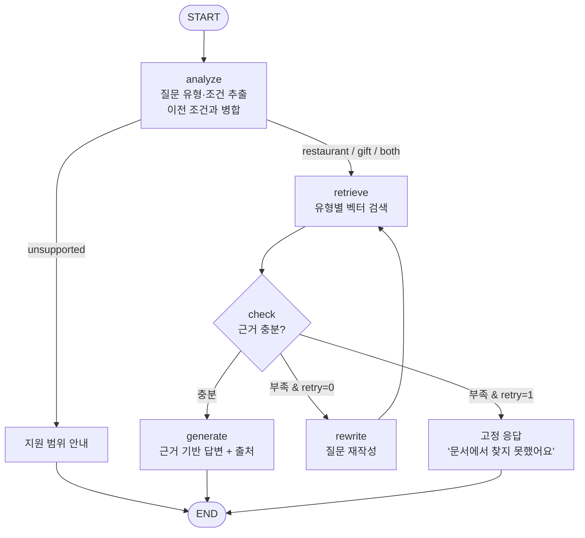

# GUESTLY 설계 문서

> 상태: 1단계(문서 설계). ⚠️ 표시는 구현 전 검증이 필요한 항목이며, 결과는 `조사노트.md`에 기록한다.

## 1. 서비스 설계

### 해결하려는 문제

해외 바이어 방문 시 담당자는 식사 장소·선물·문화적 배려를 함께 고려해야 하지만, 정보를 개별 검색해야 하고 비즈니스 상황에 맞는 선택지를 판단하기 어렵다. GUESTLY는 준비된 식당·선물 데이터와 의전 참고 문서를 검색해 후보와 추천 근거를 제시한다.

### 기능

| 기능 | 입력 예시 | 검색 조건 | 출력 |
|---|---|---|---|
| A. 식당 추천 | "독일 바이어 2명, 강남 저녁, 1인 7만 원, 조용한 곳" | 지역, 인원, 예산, 음식 종류, 분위기·대화 편의성, 식이 제한, 비즈니스 적합성 | 식당 2~3곳, 추천 이유, 예상 가격대, 확인 필요 사항, 출처 |
| B. 선물 추천 | "처음 온 미국 바이어, 5만 원 이하, 한국적, 작고 가져가기 편한 것" | 예산, 취향, 방문 목적, 한국적 특색, 휴대성, 격식, 식품·액체류 반입 주의 | 선물 2~3개, 추천 이유, 가격대, 주의사항, 출처 |
| C. 통합 추천 | 식당 + 선물 동시 요청 | A·B 조건 모두 | 두 문서를 각각 검색해 한 답변으로 정리 |

- 국가별 선호를 고정관념으로 판단하지 않고 개인 취향을 우선한다.
- 국가별 반입 규정 등 최신 확인이 필요한 정보는 단정하지 않는다.

### MVP 제외

실시간 예약, 실시간 가격·재고, 지도 API, 구매·결제, 자동 일정 관리, 다국어 음성 대화.

---

## 2. RAG 데이터 구조

### 문서 목록 (`data/`, 전부 가상 연습용 Markdown)

| 파일 | 내용 | 규모 |
|---|---|---|
| `restaurants.md` | 가상 식당의 지역, 가격, 분위기, 메뉴, 특징 | 20~30곳 |
| `gifts.md` | 가상 선물의 가격, 특징, 추천 상황, 주의사항 | 20~30개 |
| `etiquette.md` | 일반적인 비즈니스 의전 참고 지침 | 주제별 소제목 |

각 파일 맨 위에 "이 문서는 실습용 가상 데이터입니다"를 명시한다.

### 항목 작성 형식

한 항목 = 하나의 `##` 소제목. 필드는 고정된 `- 키: 값` 형태로 써서 메타데이터 추출이 쉽도록 한다.

**식당 예시**

```markdown
## R-001 한빛정 (강남)
- 식당 ID: R-001
- 지역: 강남
- 주소: 서울 강남구 강남가상길 7 (가상 주소)
- 연락처: 02-000-0001 (가상 번호)
- 음식 종류: 한정식
- 대표 메뉴: 계절 한정식 코스, 갈비찜, 궁중 신선로
- 비건·채식 메뉴: 채식 한정식 코스(사전 예약)   ← 해당 식당만
- 1인당 가격대: 60000~80000
- 추천 인원: 2~8
- 분위기: 조용함, 룸 있음
- 식이 제한: 채식 메뉴 사전 요청 가능, 돼지고기 제외 가능
- 추천 상황: 첫 미팅 후 저녁, 계약 축하
- 주의사항: 주말 영업 여부 확인 필요
```

**선물 예시**

```markdown
## G-001 나전칠기 명함 케이스
- 선물 ID: G-001
- 상품명: 나전칠기 명함 케이스
- 가격대: 30000~45000
- 카테고리: 공예품
- 주요 특징: 자개 장식, 한국 전통 공예
- 추천 대상 및 상황: 첫 방문 바이어, 격식 있는 자리
- 휴대 편의성: 작고 가벼움
- 주의사항: 파손 방지 포장 권장
```

### 메타데이터 (조각마다 저장)

| 키 | 용도 |
|---|---|
| `doc_type` | `restaurant` / `gift` / `etiquette` — 질문 유형별 검색 대상 구분 |
| `item_id` | R-001, G-001 등 |
| `source` | 파일명 |
| `heading` | 소제목 |
| `line_start`, `line_end` | 원본 Markdown 기준 줄 번호 (출처 표시용) |
| `region` | 식당 지역 (필터용) |
| `price_min`, `price_max` | 숫자형 가격 (예산 필터용) |
| `content_hash` | 조각 내용 해시 (변경 감지용) |

### 청크 분할

- 기본: **항목(`##` 소제목) 1개 = 조각 1개**. 항목이 짧아 추가 분할은 하지 않는다.
- 줄 번호는 로더가 제공하지 않을 가능성이 있으므로, 원본 파일을 줄 단위로 읽어 `##` 위치로 직접 계산하는 방식을 우선 검토한다. ⚠️
- LangChain Markdown 분할기(`MarkdownHeaderTextSplitter` 등) 사용 여부는 줄 번호 추적 가능성 확인 후 결정한다. ⚠️

### 출처 표시 형식

`파일명 > 소제목 > 시작~끝행` — 예: `restaurants.md > R-001 한빛정 (강남) > 15~24행`

### 변경 문서만 재임베딩

- `ingest.py`가 조각별 `content_hash`를 계산해 벡터 저장 파일(`vector_store.json`)에 저장된 값과 비교한다.
  - 같음 → 건너뜀 / 다름·신규 → 다시 임베딩 / 원본에서 사라짐 → 삭제
- 조각 ID는 `item_id` 기반으로 고정한다.
- 줄 번호만 바뀐 경우(내용 동일) 임베딩 없이 메타데이터만 갱신할 수 있는지 검증한다. ⚠️

### 검색 원칙

1. 질문에서 조건(유형, 지역, 인원, 예산, 식이 제한, 취향 등)을 추출한다.
2. 지역·예산 같은 명확한 제약은 메타데이터 필터 함수로 먼저 거른다. (InMemoryVectorStore는 `filter=함수` 방식, 확인됨)
3. 분위기·취향·방문 목적은 임베딩 유사도로 비교한다.
4. 관련 조각은 유형별 약 3개만 사용한다.
5. 근거가 없으면 만들어내지 않는다.
6. 사용한 조각의 출처를 표시한다.

---

## 3. LangGraph 워크플로우

### 상태(State) 항목 (초안)

| 키 | 설명 |
|---|---|
| `question` | 현재 사용자 질문 |
| `history` | 최근 대화 (최대 4개 메시지) |
| `intent` | `restaurant` / `gift` / `both` / `unsupported` |
| `conditions` | 추출 조건 (이전 조건과 병합된 결과) |
| `docs` | 검색된 조각 + 점수 |
| `retry_count` | 재검색 횟수 (0 또는 1) |
| `answer` | 최종 답변 |

### 흐름



### 노드 설명

| 노드 | 역할 | 모델 호출 |
|---|---|---|
| analyze | 질문 유형 분류 + 조건 추출, 변경 안 된 이전 조건 유지 | 생성 모델 1회 (구조화 출력) ⚠️ |
| retrieve | `doc_type`별 필터 + 유사도 검색. `both`면 식당·선물 각각 검색 | 질문 임베딩 |
| check | 점수 기준선 + 조건 일치 여부로 근거 충분성 판정 | 없음 (규칙 기반 우선) |
| rewrite | 검색어를 조건 중심으로 다시 작성 (최대 1회) | 생성 모델 1회 |
| generate | 검색 조각만 근거로 추천·이유·주의사항·출처 작성 | 생성 모델 1회 |
| 고정 응답 | "문서에서 찾지 못했어요" 반환 | 없음 |

### 근거 부족 판정

- **검색 결과가 있다는 사실만으로 충분하다고 보지 않는다.**
- 점수는 코사인 유사도(높을수록 유사, 최대 1). 실험 결과 점수 하나로는 관련·무관을 가를 수 없어 아래 4단계로 판정한다 (`조사노트.md` 3-1, 3-6~3-8장).

| 순서 | 판정 | 처리 | 생성 모델 |
|---|---|---|---|
| ① | analyze가 지원하지 않는 요청으로 분류 | 지원 범위 안내 | analyze 1회만 |
| ② | 예산·지역 필터 후 후보 0개 | "문서에서 찾지 못했어요" (재검색 생략) | analyze 1회만 |
| ③ | 1위 점수 < 0.40 (`config.SCORE_THRESHOLD`, 잠정값) | 재검색 1회 → 그래도 미만이면 고정 응답 | 고정 응답 시 generate 호출 안 함 |
| ④ | 점수는 통과했지만 generate가 "요청 품목에 맞는 후보 없음"(`no_match_types`)으로 판단 | 해당 유형만 고정 응답 | ⚠️ generate 1회 호출 후 판정 (기획서 원칙의 예외, 사용자 승인) |

- 검색 글: 임베딩에는 이름 + 핵심 필드만 쓰고(식이 제한의 부정 표현 제외), 답변 생성에는 원문 전체(`metadata["full_text"]`)를 쓴다.
- 출처: 답변에 이름이 나온 항목만 표시한다.

### 후속 질문 (피드백)

- 예: "좀 더 저렴한 곳으로", "선물은 전통적인 느낌으로"
- analyze가 이전 `conditions`를 받아 **바뀐 항목만 덮어쓰고** 나머지는 유지한 뒤 다시 검색한다.
- 이전 조건은 Streamlit 세션 상태에 저장한다.

### 통합 요청 처리

`both`일 때 식당·선물을 각각 검색하고 각각 근거를 판정한다. 한쪽만 부족하면 그쪽에만 "문서에서 찾지 못했어요"를 표시하고 나머지는 정상 추천한다.

---

## 4. Streamlit UI

| 영역 | 내용 |
|---|---|
| 상단 | GUESTLY 로고·서비스 설명, 가상 연습 데이터 사용 안내 |
| 첫 화면 | 빠른 시작 버튼 4개(식당 추천, 선물 추천, 식당+선물, 바이어 정보 입력) → 누르면 입력 폼이 열리고, 제출하면 질문 문장으로 바꿔 보낸다. 예시 질문 3개도 버튼으로 바로 보낼 수 있다 |
| 중앙 | 채팅 내역, AI 추천 답변, 추천 근거·출처 |
| 하단 | 입력창 (`st.chat_input`) |
| 사이드바 | 대화 초기화, 바이어 정보 요약·수정, 추천 기능 소개, 데이터·비용 안내(오늘/이번 달 예상 사용액) |

- 디자인 콘셉트: **한지 위의 비즈니스 서신**. 한지색 배경(#F5EFE3), 먹색 글씨(#1E2633), 단청 주홍(#B4432B) 도장 로고 '客'(손님 객), 청자색(#5E8C7F) 보조색. 제목 Gowun Batang, 본문 IBM Plex Sans KR(Google Fonts). 사이드바는 먹색 "의전 수첩", 예상 사용액은 진행 막대. 테마는 `.streamlit/config.toml`, CSS는 `ui_style.py`.
- 바이어 정보(소속, 인원, 음주, 방문 목적, 식이 제한, 취향)는 세션에 저장하고, 이후 질문 앞에 `[바이어 정보] ...` 한 줄로 붙여 보낸다. 국적으로 취향을 짐작하지 않도록 폼에 안내 문구를 둔다.
- 답변 끝에 코드가 붙이는 항목: **식당 정보**(주소·연락처·대표 메뉴·비건·채식 메뉴, 데이터 그대로), **예산 확인**(가격 최대값 > 예산인 항목). 모델이 쓰지 않으므로 항상 정확하다.

### 답변 형식 (채팅형, 과한 카드 UI 지양)

```
**추천 식당**
1. 식당 A — 추천 이유 (예상 1인 6~8만 원)
2. 식당 B — 추천 이유

**주의사항**
예약 가능 여부와 실제 영업 정보는 별도 확인이 필요해요.

**출처**
restaurants.md > 식당 A > 15~24행
```

---

## 5. 비용·안전 장치 요약

- 문서 임베딩은 `ingest.py`에서만, 변경분만.
- 검색 조각 약 3개, 최근 대화 최대 4개, 재검색 최대 1회.
- 근거 부족 시 생성 모델 호출 안 함 (예외: 위 판정 ④).
- 호출 전 로컬 사용량 기록으로 일 $1 / 월 $5 한도 확인 (실제 청구 차단은 보장하지 않음).
- 질문 1건당 생성 모델 호출: 최소 1회(지원 안 함·후보 0개), 보통 2회(analyze, generate), 최대 4회(통합 요청에서 두 유형 모두 rewrite).
- 실측 비용: 질문 1건 약 $0.0003~0.0005 (gpt-6-luna, `reasoning_effort="none"`).

---

## 7. 배포 (예정, 5단계 이후)

- 대상: **Streamlit Community Cloud**. Vercel은 서버리스 방식이라 Streamlit(서버가 계속 켜져 있고 브라우저와 연결 유지)과 맞지 않는다.
- API 키: `.env` 대신 Streamlit Cloud의 Secrets에 `OPENAI_API_KEY`를 넣는다. 코드가 환경변수로 읽을 수 있는지 배포 시 확인한다. ⚠️
- 벡터 파일: `store/vector_store.json`을 저장소에 커밋하는 방식을 우선 검토한다 (앱 시작 시 임베딩하면 "임베딩은 ingest.py에서만" 규칙과 충돌).
- 예산: 클라우드는 재시작 시 로컬 파일이 지워질 수 있어 `usage_log.jsonl` 기반 한도가 초기화될 수 있다. OpenAI 대시보드 사용 한도를 함께 설정한다.
- 공개 범위: 앱을 비공개(초대한 사람만)로 두어 API 비용 남용을 막는다.
- 실행 경로: 저장소 `AX_2` 안의 `1117 실습/app.py`.

---

## 6. 파일 구성 (예정, 코드 작성은 승인 후)

| 파일 | 역할 |
|---|---|
| `ingest.py` | 문서 로딩 → 조각 분할 → 변경 감지 → 임베딩 → JSON 파일 저장 |
| `md_loader.py` | Markdown을 항목 단위로 나누고 줄 번호·메타데이터·검색 글 생성 |
| `rag.py` | 벡터 검색, 필터, 출처 문자열 생성 |
| `llm.py` | 생성 모델 호출 (호출 전 예산 확인, 호출 후 사용량 기록) |
| `graph.py` | LangGraph 상태·노드·분기 |
| `usage.py` | 사용량 기록과 예산 확인 |
| `app.py` | Streamlit 화면 |
| `config.py` | 모델명, 검색 개수, 예산, 경로 등 설정값 |
| `.env.example` | 환경변수 이름만 (값 없음) |

파일 분리 방식은 구현 단계에서 조정할 수 있다.
